# 결과 설명 자료

| 과제명 | 감귤의 신(神), 데이터로 읽는 제주 감귤 수급 비서 |
| --- | --- |
| 팀 | 알맹이 (김태양, 오동경, 류채연) |
| 작성일 | 2026년 11월 19일 |

이 문서는 제주 감귤 데이터 분석 결과와, 그 결과를 질문으로 조회할 수 있게 만든 질의응답 에이전트를 설명합니다. 수치는 모두 분석 노트북(`notebooks/01~04`)과, 출처 문서와 대조를 마친 에이전트의 분석 카드(`citrus_freellm/knowledge/cards.json`)에서 옮겼습니다.

> 단위: 분석 그래프는 프로젝트 공통 단위인 백만원/ha, 에이전트 답변은 표준소득표 원래 단위인 만원/10a를 씁니다. 1백만원/ha = 10만원/10a입니다(예: 159백만원/ha = 1,590만원/10a).

---

## 1. 주요 결과 요약

| 항목 | 결과 |
| --- | --- |
| 생산량과 가격 | 노지온주는 생산량이 1% 늘면 단가가 약 2~3% 떨어졌다(로그 기울기 전체 기간 −2.2, 최근 10년 −2.9). 제주 생산량이 약 47만 톤을 넘으면 평균 농가가 생산비 기준 적자가 된다(가격 변동 감안 39~56만 톤). |
| 품종별 수익성 | 매출은 하우스온주가 가장 높지만, 경영비를 뺀 소득은 천혜향이 9년 모두 2위 안에 들었고 2024년산은 1위였다. 하우스온주 실질 소득은 2016년산 대비 2024년산 약 40% 줄었다. |
| 물가 보정 | 노지온주 실질 단가는 2017~2025년 CPI 기준 +16.8%, 노지 경영비지수 기준 −4.9%였다. 가격 상승폭이 농사 비용 상승폭보다 작았다. |
| 출하 시기 | 노지온주 10월 가격은 12월의 0.67~1.01배였고, 2월은 12월의 약 1.0~1.8배로 시즌별 차이가 컸다. |
| 기상 | 장기 추세를 제거한 뒤 여름 평균기온과 단가의 상관은 +0.83, 폭염일수와 면적당 생산량의 상관은 −0.47이었다. 인과관계는 이 자료로 확인할 수 없다. |

---

## 2. 분석 결과

### 2.1 생산량과 가격 (노트북 02 §1·3)
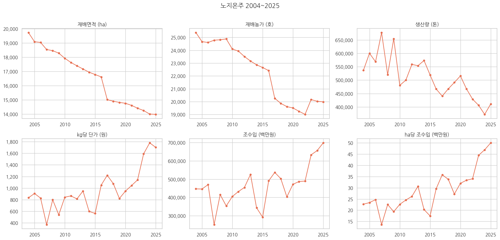
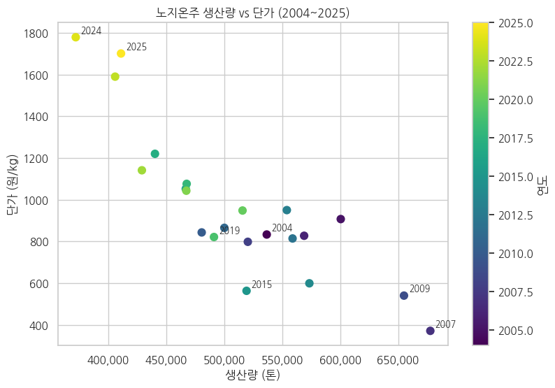

- 2004~2025년 22개 연도에서 노지온주 생산량과 단가의 상관계수는 −0.86, 로그 관계의 기울기는 전체 기간 약 −2.2, 최근 10년 약 −2.9입니다.
- 기울기의 절댓값이 1보다 크다는 것은 물량이 늘 때 가격이 그보다 더 크게 떨어져 총매출이 오히려 줄 수 있다는 뜻입니다.
- 한계: 관측된 관계이며, 특정 해의 원인이나 미래 가격 공식으로 쓰면 안 됩니다.

### 2.2 출하 시기 (노트북 02 §6)
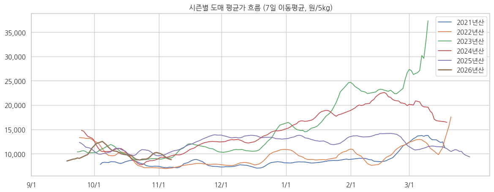

- 2021~2025년산 5개 시즌, 출하량 가중 도매가격 기준으로 10월 가격은 12월의 0.67~1.01배로 대체로 낮거나 비슷했습니다.
- 2월 가격은 12월의 약 1.0~1.8배로 시즌마다 차이가 컸습니다(2023년산은 3월에 급등).
- 한계: 저장 비용·감모를 빼지 않은 가격 비교라, 늦게 팔면 이익이 늘어난다고 보장하지 않습니다.

### 2.3 날씨와 생산량·가격 (노트북 02 §4)
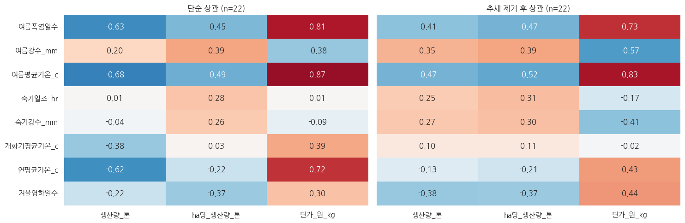

- 제주·고산·성산·서귀포 4개 지점 기상을 연도별로 요약해, 장기 추세를 제거한 뒤 상관을 봤습니다.
- 여름 평균기온–단가 +0.83, 폭염일수–단가 +0.73, 폭염일수–면적당 생산량 −0.47.
- 해석: 더웠던 해에 수확이 적고 값이 높았던 연관성입니다. 폭염이 직접 원인인지는 이 자료만으로 구분할 수 없습니다.

### 2.4 품종별 매출과 소득 (노트북 02 §2, 03 §1)
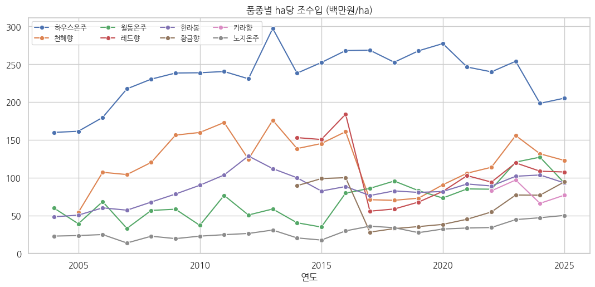
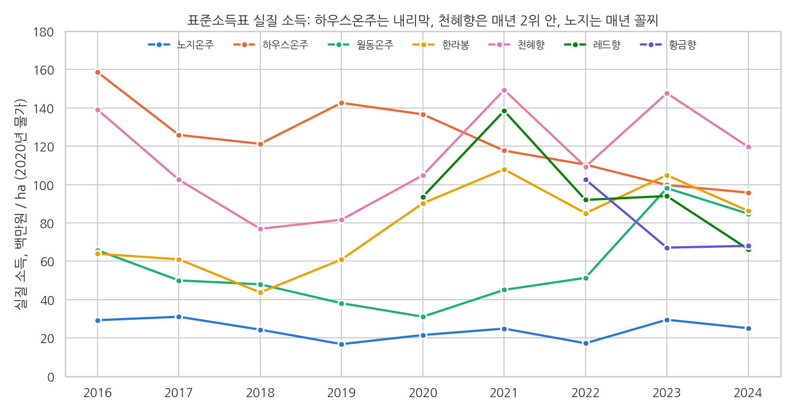

- 매출(ha당 조수입): 최근 3년 평균 하우스온주가 약 2.2억원/ha로 노지온주의 약 4.6배, 천혜향 2.9배, 월동온주·레드향 2.4배.
- 경영비를 뺀 소득(표준소득표 2016~2024년산, 표본 농가 10a당):
  - 하우스온주는 9년 중 6년 1위였지만 실질 소득이 2016년산 1,586.5만원/10a에서 2024년산 958.4만원/10a로 줄었습니다(2019년산 한 번 반등). 경영비율이 41%에서 53~56%로 올랐기 때문입니다.
  - 천혜향은 9년 모두 2위 안, 2021·2023·2024년 1위. 2024년산은 매출 1위 하우스온주(2,333.5만원/10a)보다 천혜향 소득(1,366.9만원/10a)이 높았습니다.
  - 노지온주는 9년 내내 꼴찌, 생산비까지 빼면 2019·2022년산은 적자였습니다.
- 한계: 소득은 자가노동·자기자본 보상이 남은 값이라 순이익이 아닙니다. 묘목·시설 투자 같은 전환 비용은 없습니다.

### 2.5 물가 보정 (노트북 03 §2)
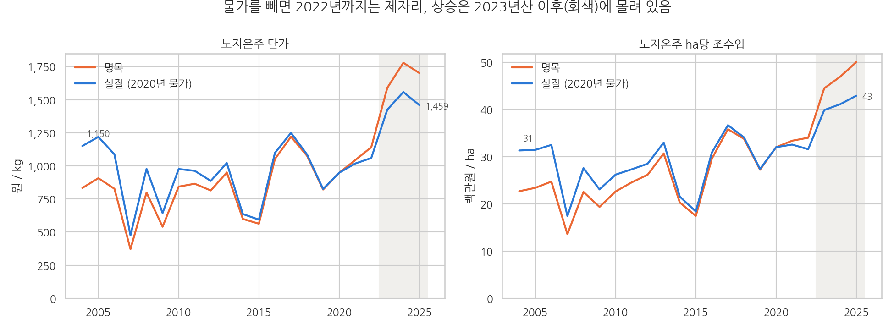

- 노지온주 실질 단가(CPI 기준)는 2004~2025년 +26.8%, 2017~2025년 +16.8% 올랐습니다.
- 같은 2017~2025년을 농가구입가격지수로 보정하면 +9.0%, 노지 경영비지수로 보정하면 −4.9%입니다. 같은 기간 노무비는 2.9배, 농약비는 2.4배가 됐습니다.
- 2004~2022년만 보면 CPI 기준 실질 단가는 −8%로, 장기 상승분은 대부분 2023~2025년산 3개 시즌에서 생겼습니다.
- 최근 가격 상승폭은 생활물가 상승폭보다 컸지만 농사 비용 상승폭보다는 작았습니다.
- 품질 이슈 Q9(2017년 면적 통계 단절)를 피하려고 품종 비교는 2017~19년 평균과 2023~25년 평균으로 계산했습니다.

### 2.6 노지온주 손익분기 (노트북 04 §1)
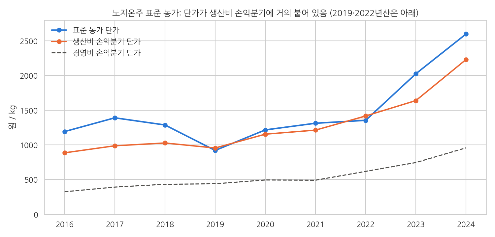
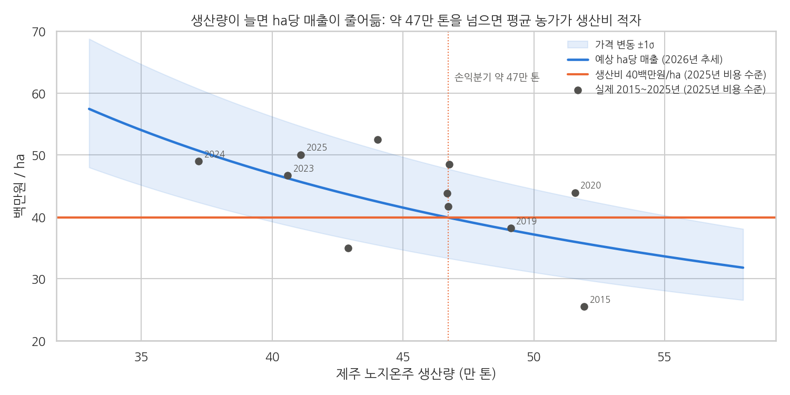

- 표준 농가의 생산비 손익분기 단가는 2016년 885원/kg, 2024년 2,229원/kg입니다. 실제 단가는 그 0.96~1.41배로 거의 붙어 있고, 2019·2022년산은 손익분기보다 낮았습니다.
- 제주 평균 농가는 경영비 기준으로 9년 내내 흑자였지만 생산비 기준으로는 2019~2022년산 4년 연속 적자였습니다.
- 생산량–매출 관계에 2026년산 비용 수준을 넣으면, 제주 노지온주 생산량 약 47만 톤을 넘을 때 평균 농가가 생산비 기준 적자가 됩니다(가격 변동 ±20% 감안 39~56만 톤). 2026년산이 45만 톤(+10%)이면 순수익 약 +20만원/10a, 50만 톤(+22%)이면 약 −30만원/10a.
- 활용: 농업관측센터의 2026년산 생산 전망이 나오면 이 경계와 비교해 출하 조절 판단에 쓸 수 있습니다.

### 2.7 소득 변화 요인 분해 (노트북 04 §2)
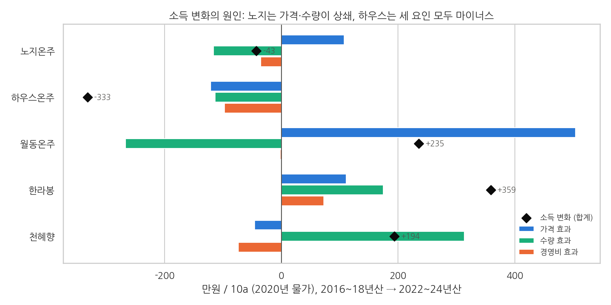

소득 = 단가 × 수량 + 부산물 − 경영비로 나눠, 2016~18년산 평균 대비 2022~24년산 평균의 변화를 가격·수량·경영비 효과로 분해했습니다(2020년 물가, 10a당).
- 노지온주: 실질 단가 +31%(+108만원)를 수량 −25%(−116만원)가 상쇄하고 경영비 증가(−35만원)만큼 줄어 −43만원.
- 하우스온주: 가격(−121)·수량(−114)·경영비(−97) 모두 마이너스로 −333만원, 가장 크게 줄었습니다.
- 월동온주는 단가 55% 상승으로 +235만원, 천혜향·한라봉은 수확량 증가(+20%, +14%)로 늘었습니다.
- 표준 농가의 단가와 수량은 상관 −0.88로, 값이 좋은 해는 수확이 적은 해였습니다.

### 2.8 표준소득표와 제주 평균의 차이 (노트북 04 §3)
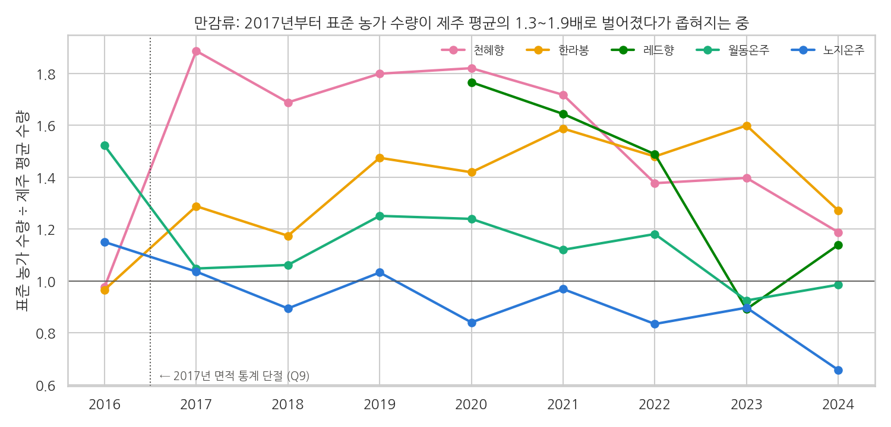

- 만감류는 표준 농가 총수입이 제주 평균의 1.14~3.71배(중앙값 1.73배)이고, 차이는 대부분 수확량에서 나옵니다(천혜향: 수량 비 1.69배, 단가 비 1.16배로, 차이의 약 90%가 수량에서 나옴).
- 천혜향 수량 비는 2016년 0.98배에서 2017년 1.89배로 뛰었습니다. 2017년부터 아직 수확하지 못하는 어린 과원이 재배면적에 포함됐다는 설명(품질 이슈 Q9)과 맞습니다.
- 따라서 표준표를 신규 진입 농가의 기대 소득으로 쓰면 높게, 제주 평균 ha당 매출은 성과수 농가보다 낮게 나옵니다.

### 2.9 품종별 경영비 물가 (노트북 04 §4)
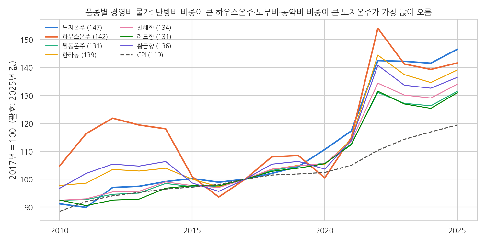

- 비용 구성이 품종마다 다릅니다: 하우스온주는 난방(영농광열비) 43%, 노지온주는 노무비 27%·농약비 22%, 만감류는 시설 상각 38~56%.
- 2017년 이후 경영비 물가는 하우스온주 +42%, 노지온주 +47%로 가장 많이 올랐고 만감류는 +31~39%였습니다(CPI +19%).
- 비용 물가로 보정한 ha당 실질 매출: 하우스온주 −38%, 한라봉 −6%, 노지온주 +4%. 천혜향·레드향·황금향은 실질 단가가 −9~−13%지만 수확량 증가로 +48~+101%.

---

## 3. 질의응답 에이전트

### 3.1 구조와 동작 방식
- 수치 계산: 모든 수치는 로컬 정제 데이터에서 계산합니다. Claude 상담 모드에서도 모델은 질문 해석과 문장 정리만 맡고, 답에 나온 숫자를 조회 결과와 자동 대조해 근거 없는 숫자가 있으면 다시 쓰게 하거나 뺍니다.
- 답변 구성: 결론, 표·계산 근거, 출처 순서로 보여 주고, 표본 농가 기준·순이익 아님 같은 한계를 함께 밝힙니다.
- 답변 범위: 미래 값 예측과 원인 단정은 하지 않고, 이유를 말한 뒤 지난 기록으로 답할 수 있는 질문을 제안합니다.
- 실행 조건: API 키가 없으면 로컬 규칙으로 답하고, 키가 있으면 애매한 질문(예: "창업하려는데 어떤 품종이 좋아?")에 조건을 되물으며 상담합니다.

### 3.2 화면

| 시작 화면 | 메인 화면 |
| --- | --- |
| 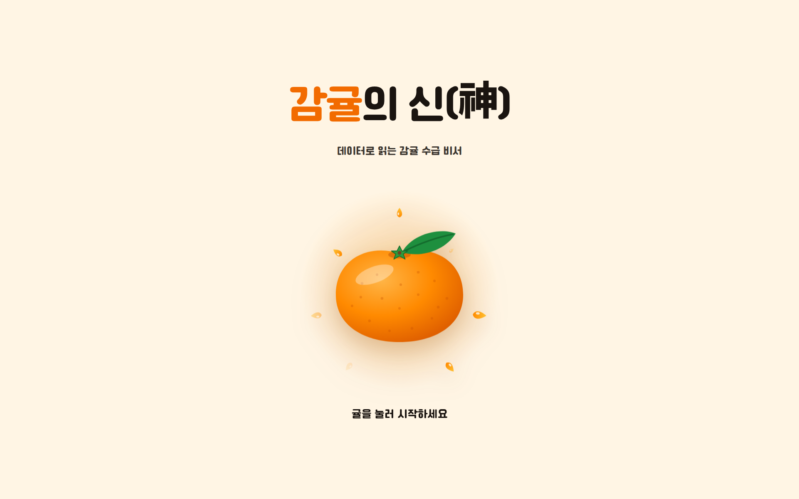 | 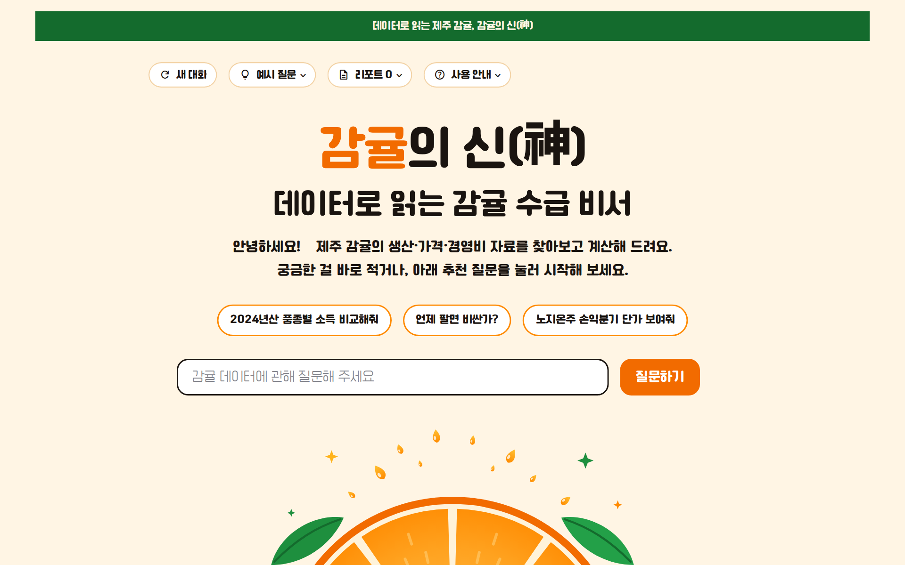 |

시작 화면에서 귤을 누르면 메인 화면으로 들어갑니다. 추천 질문을 누르거나 질문을 적으면 됩니다.

품종별 소득 비교. 표와 그래프, 계산 확인, 출처를 함께 보여 줍니다.
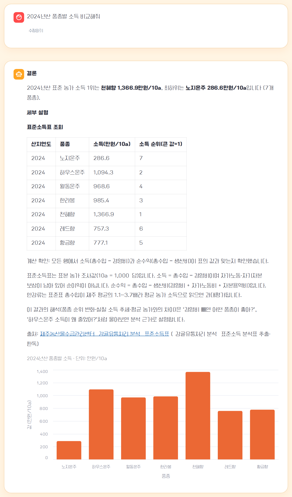

손익분기 단가. 실제 단가와 경영비·생산비 손익분기 단가를 한 그래프로 비교합니다.
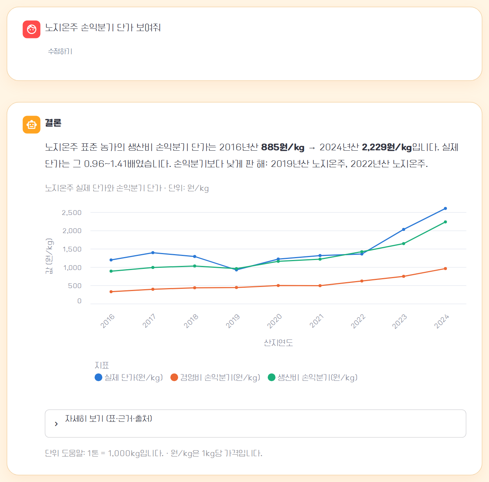

비교 질문과 그래프 바꾸기. "그래프로 그려줘", "막대그래프로 바꿔줘"로 같은 수치를 다른 모양으로 봅니다.
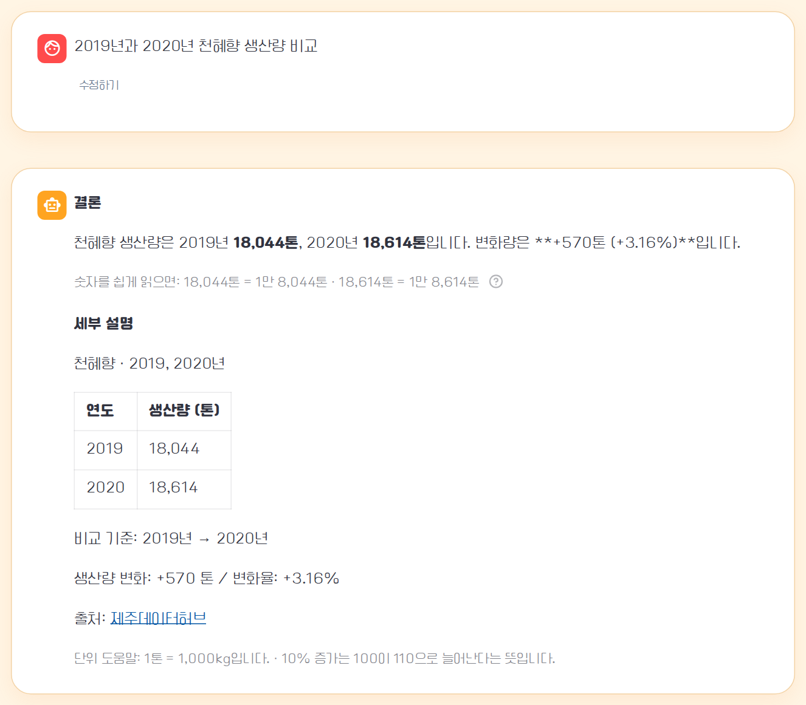
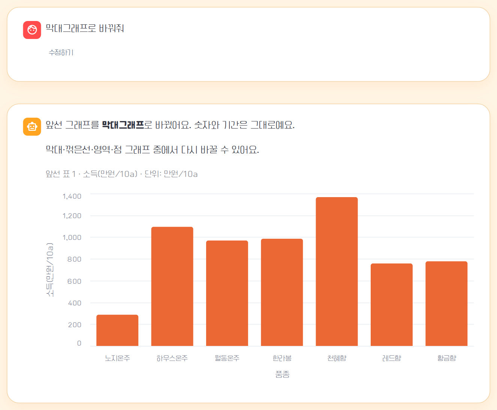

출하 시기. 분석 결과를 근거와 한계와 함께 답합니다.
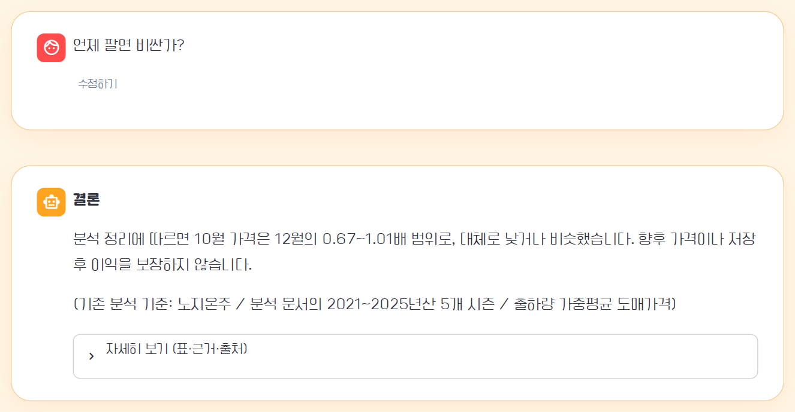

예측 질문 안내. "내년 귤값 얼마야?"에는 예측하지 않는 이유를 밝히고 답할 수 있는 질문을 제안합니다.
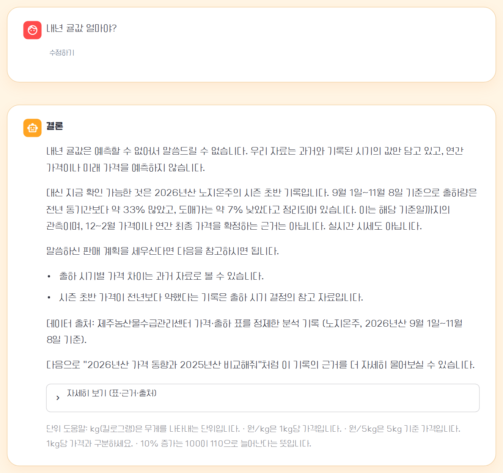

Claude 상담 모드. 조건이 애매한 질문에 근거 수치를 정리하고, 재배 방식을 선택지로 되묻습니다.
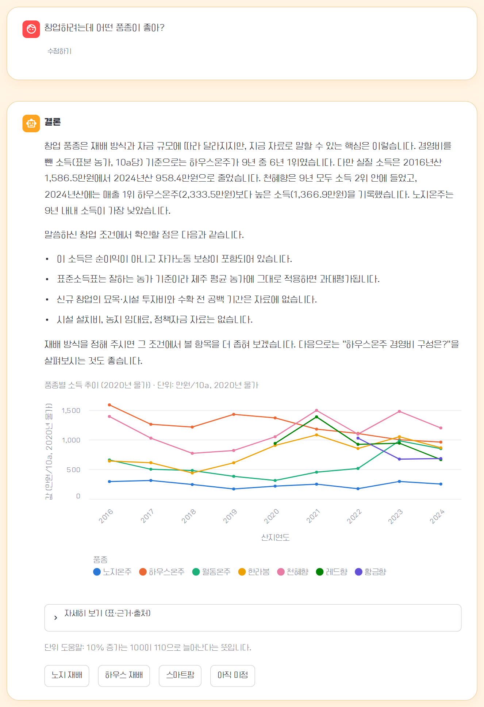

리포트 내보내기와 휴대폰 화면

| 리포트 (PDF·Markdown) | 휴대폰 (390px) |
| --- | --- |
| 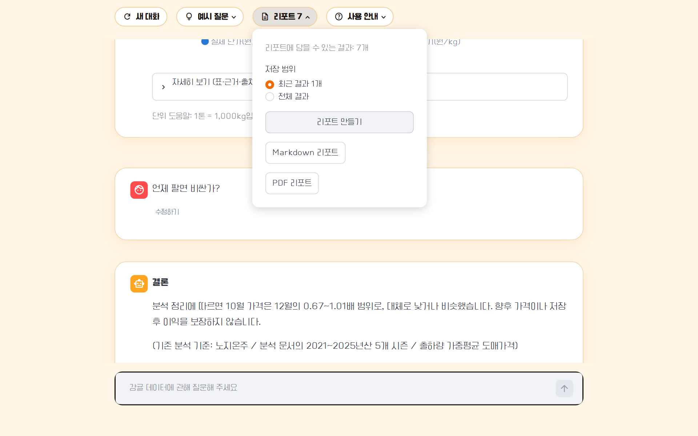 | 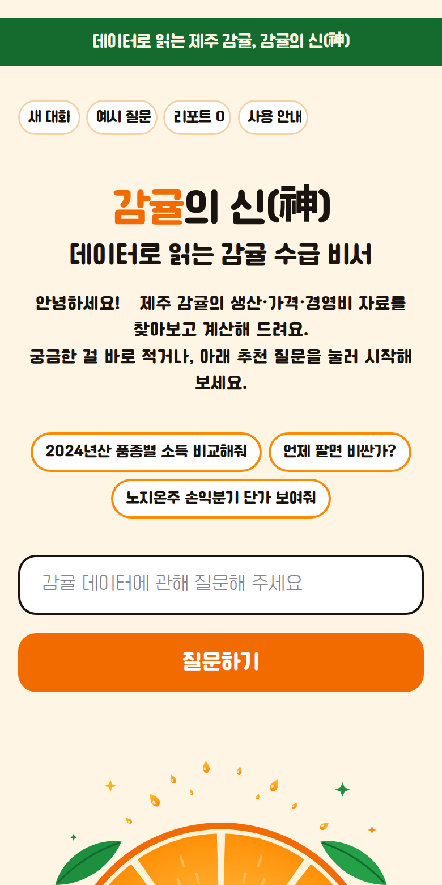 |

---

## 4. 검증

| 항목 | 결과 (2026-11-18) |
| --- | --- |
| 데이터 정제·품질 자동 검사 | 52개 통과 |
| 에이전트·화면 자동 검사 | 263개 통과 (유료 모델 호출 없이) |
| 경영비·손익분기 질문 오프라인 평가 | 16/16 |
| 분석 노트북 01~04 처음부터 다시 실행 | 4개 모두 오류 없음 |
| 정제 데이터 재생성 | 기존 파일과 바이트 단위로 같음 |
| 표준소득표 검산 | 모든 행에서 소득 = 총수입 − 경영비, 순수익 = 총수입 − 생산비 (±1원) |
| 화면 | 데스크톱(1366·1536·1920px)·휴대폰(390px), 브라우저 오류 0건 |

---

## 5. 한계와 향후 계획

- 예측: 2026년산 가격 시험 모델의 오차(MAPE 16.1%)가 '전년 가격 그대로' 기준선(16.9%)과 비슷해, 에이전트는 예측값을 답하지 않습니다. 농업관측센터 2026년산 생산 전망이 나오면 손익분기 경계(약 47만 톤)와 비교하는 기능부터 붙일 계획입니다.
- 표본 농가 기준: 표준소득표는 잘하는 표본 농가 기준이라, 평균 농가·신규 진입 농가의 소득은 따로 보정해야 합니다(2.8절).
- 빠진 자료: 병해충, 가온·시설 재배 조건, 농지 가격·시설 설치비·정책자금은 아직 없습니다. 월별 상자규격 가격은 2024 시즌만 있습니다.
- 데이터 이용 조건: 제주농산물수급관리센터 자료는 약관상 함께 배포하지 못해, 받는 절차와 정제 코드만 제공합니다.
